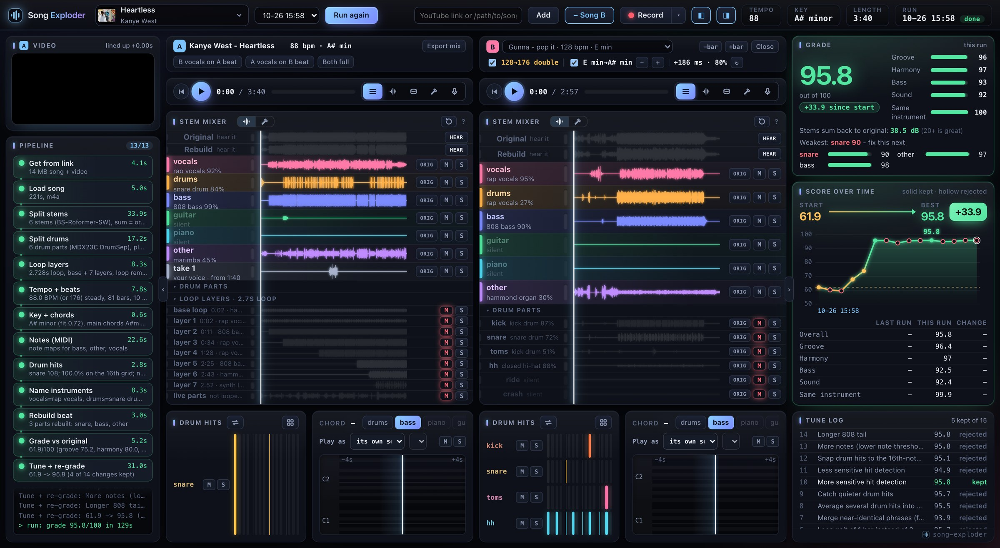
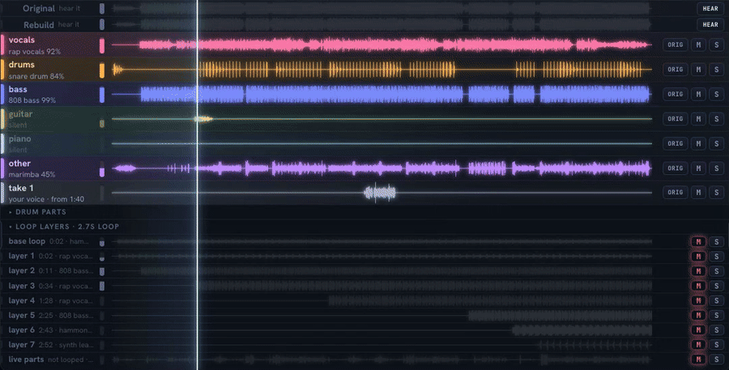
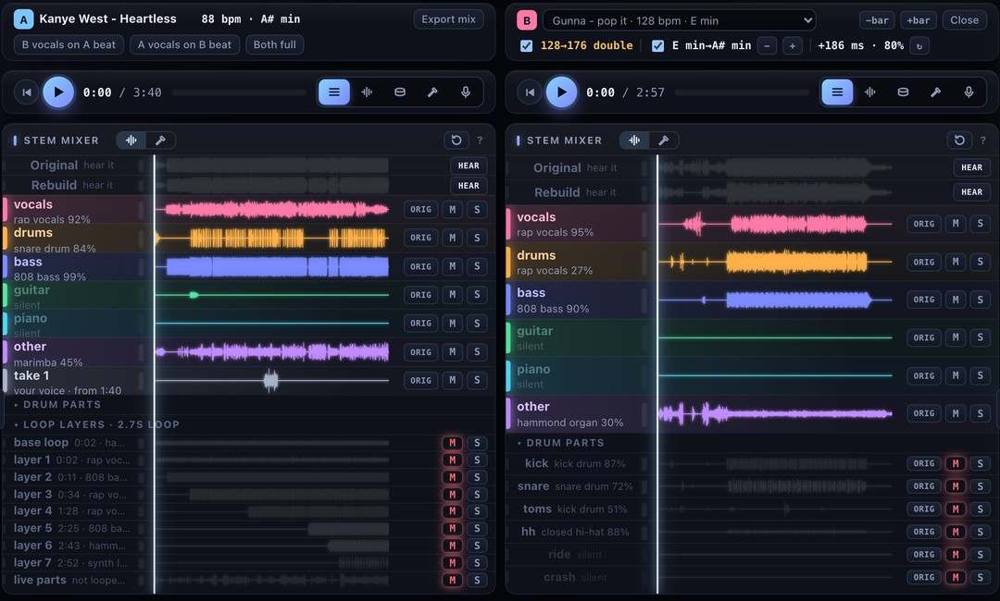
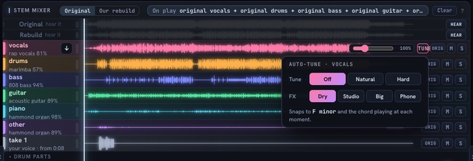
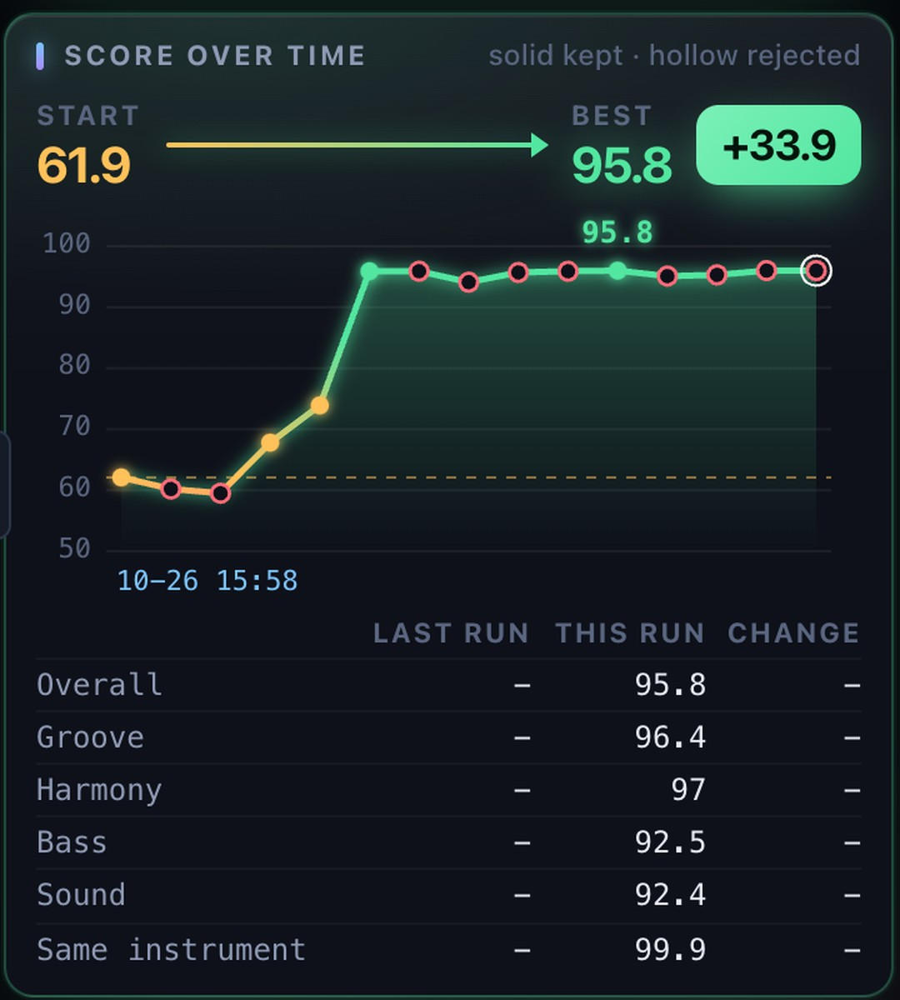
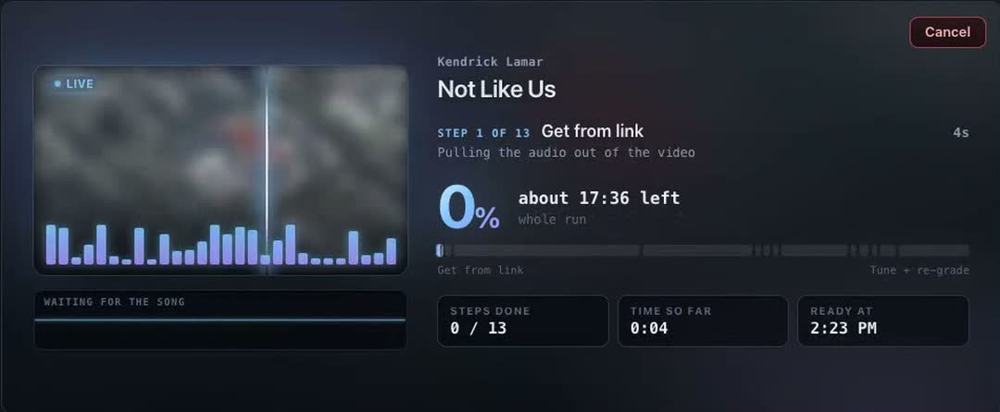

<p align="center">
  
</p>

<h1 align="center">Song Exploder</h1>

<p align="center">
  <b>Every song is a recipe. Read it</b><br>
  Drop in any song and hear the vocals, drums, bass and chords on their own. Runs on your Mac.
</p>

<p align="center">
  <a href="#install">Install</a> ·
  <a href="#hear-every-part-on-its-own">Features</a> ·
  <a href="#it-grades-itself">The grade</a> ·
  <a href="docs/HOW-IT-WORKS.md">How it works</a> ·
  <a href="https://tools.techguyverlabs.org/t/song-exploder">Try it in the browser</a>
</p>

---

Paste a YouTube link or drop an MP3. A few minutes later you have:

- **6 stems**: vocals, drums, bass, guitar, piano, other
- **6 drum parts**: kick, snare, toms, hi-hat, ride, crash
- **Tempo, key and chords**, with every beat on a grid
- **A MIDI file** of the bass, guitar, piano and other parts
- **The name of each instrument**: "808 bass", "rap vocals", "hammond organ"
- **A rebuilt beat**, made only from what it found, graded against the original

Everything runs on your own machine. Your songs never leave it.

## Install

You need a Mac with Apple silicon, [Homebrew](https://brew.sh) and about 6 GB of free disk.

```sh
brew install ffmpeg rubberband fluid-synth uv node
git clone https://github.com/royherma/song-exploder.git
cd song-exploder
scripts/install.sh
node server.mjs
```

Open **http://localhost:4843** and drop a song on the page. The first song downloads the models (about 2 GB), after that it starts right away.

**Use Claude Code?** Install it as a plugin and ask Claude to explode a song:

```sh
claude plugin marketplace add royherma/techguyver-tools
claude plugin install song-exploder@techguyver-tools
```

## Hear every part on its own



Solo any stem, mute any drum part, drag a volume. Press **A** to flip between the original song and the rebuilt beat at the same spot. Download any stem with one click.

## Put one song's vocals over another song's beat



Click **+ Song B** and load a second song. Song B is re-timed and re-pitched to Song A's tempo and key, then nudged so its drum hits land on Song A's. One play button runs both. **Export mix** writes the result as one WAV.

## Sing over it, auto-tuned to the song



Hit **Record** and sing over any song from wherever the playhead is. Your take lands as its own row, lined up with the beat. **Tune** snaps every note to the song's key and to the chord playing at that moment, with Natural or Hard settings and Studio, Big or Phone effects.

## It grades itself



Song Exploder rebuilds the beat using only what it pulled out: drum hits played back with one-shots cut from the song's own drum stem, and notes played by a simple synth. Then it compares that rebuild with the original:

| Part | What it checks | Weight |
| --- | --- | --- |
| Groove | Do the hits land at the same moments | 30% |
| Harmony | Are the same notes sounding at the same time | 25% |
| Bass | The low end, under 250 Hz | 20% |
| Sound | The whole spectrum, 64 bands | 25% |

After the first pass it tries 14 changes to its own settings, one at a time, and keeps each one only if the grade goes up. On Kanye's *Heartless* that took the rebuild from **61.9 to 95.8**.

The weakest part is named on screen ("Weakest: snare 90, fix this next"), so you always know what it got wrong.

<br clear="right">

## Paste a link, watch it work



Every step shows live: what it is doing, how long it took, and when the song will be ready.

## Run it from the terminal

```sh
.venv/bin/python bin/reverse.py ~/Downloads/song.mp3
```

Runs started here show up in the page too. Each song gets its own folder in `songs/<name>/` with the stems, drum parts, MIDI and a full report.

## Built on

| Job | Model or library |
| --- | --- |
| Stems | [BS-RoFormer](https://github.com/nomadkaraoke/python-audio-separator) and [Demucs](https://github.com/facebookresearch/demucs) htdemucs_6s |
| Drum parts | MDX23C DrumSep via [audio-separator](https://github.com/nomadkaraoke/python-audio-separator) |
| Notes to MIDI | [Basic Pitch](https://github.com/spotify/basic-pitch) by Spotify |
| Instrument names | [CLAP](https://huggingface.co/laion/clap-htsat-unfused) by LAION |
| Tempo, key, chords | [librosa](https://librosa.org) |
| Re-timing for mashups | [Rubber Band](https://breakfastquay.com/rubberband/) |
| Auto-tune and effects | WORLD vocoder ([pyworld](https://github.com/JeremyCCHsu/Python-Wrapper-for-World-Vocoder)) and [pedalboard](https://github.com/spotify/pedalboard) |

The full pipeline, the files it writes and the tricks behind the beat grid are in [docs/HOW-IT-WORKS.md](docs/HOW-IT-WORKS.md).

## License

MIT. Made by [TechGuyver Labs](https://techguyverlabs.org).
